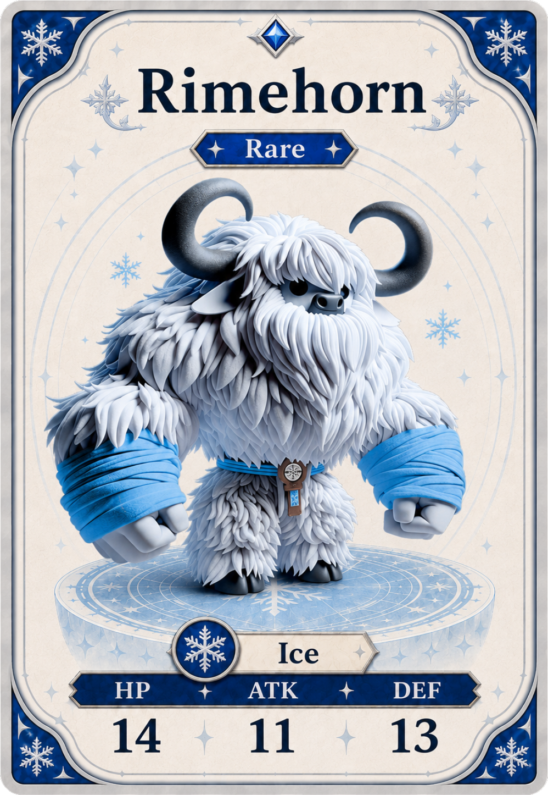
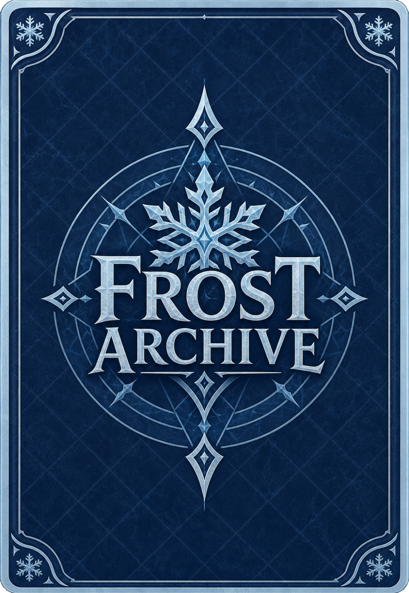
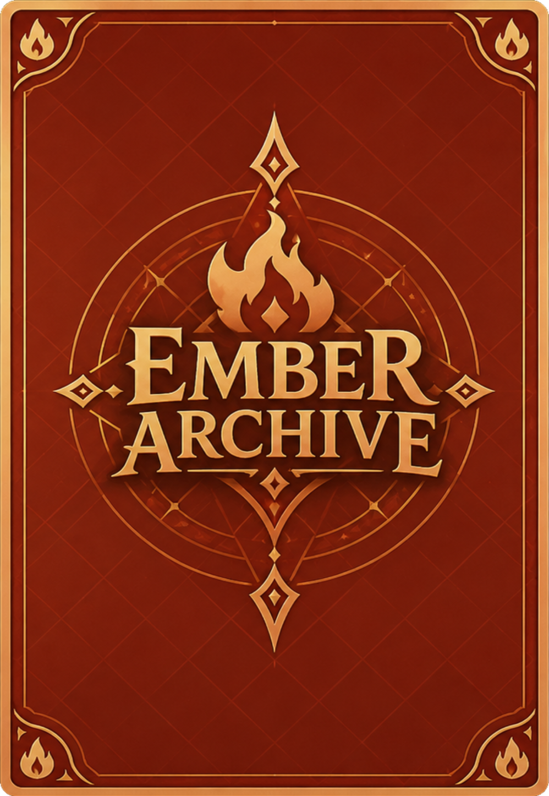
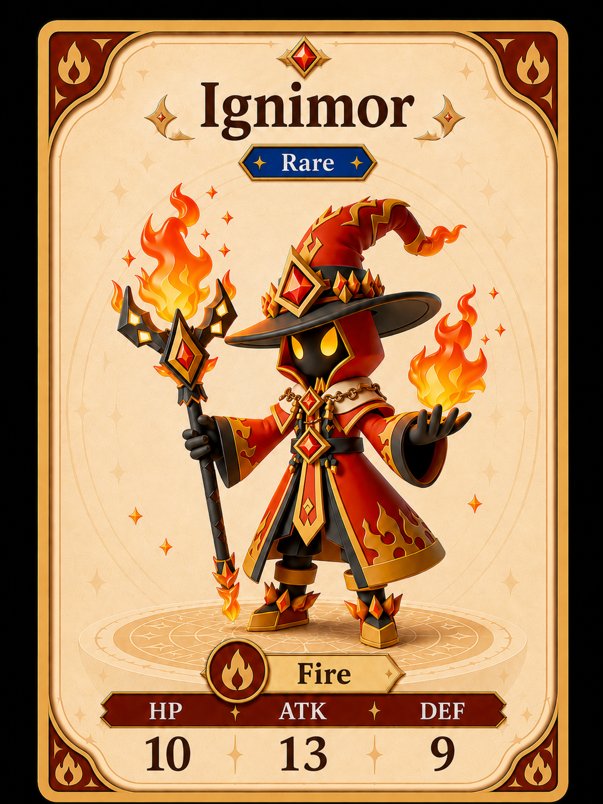
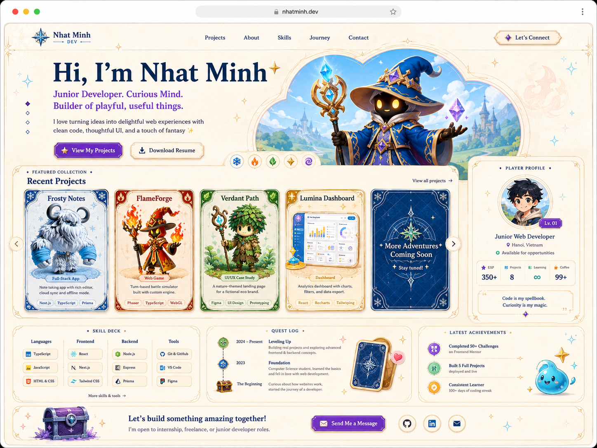

# Cardfolio Portfolio — Tổng hợp ý tưởng & tài liệu tham khảo

> Tài liệu định hướng cho portfolio cá nhân theo concept game thẻ bài, dành cho Fresher/Junior Developer.

## 1. Bối cảnh và yêu cầu chính

Portfolio sử dụng ngôn ngữ hình ảnh của **collectible/trading card game**, nhưng không được biến thành một giao diện game khó sử dụng. Concept thẻ bài chỉ đóng vai trò nhận diện thương hiệu và cách kể chuyện; mục tiêu chính vẫn là giúp nhà tuyển dụng hiểu nhanh:

- Tôi là ai?
- Tôi đang tìm vị trí nào?
- Tôi đã làm những dự án gì?
- Vai trò và đóng góp của tôi trong từng dự án là gì?
- Tôi đã sử dụng công nghệ nào?
- Tôi học được điều gì từ dự án?

### Các ràng buộc đã xác định

1. **Không sử dụng dark mode làm giao diện chính.**
2. Ưu tiên màu sắc **tươi sáng, cá tính, trẻ trung**.
3. Chủ portfolio là **Fresher/Junior**, vì vậy cách viết phải trung thực, không tự định vị như chuyên gia hoặc senior.
4. Bộ thẻ có **nhiều hệ nguyên tố**, không chỉ Frost và Ember.
5. Màu của website không được phụ thuộc vào màu của một bộ Archive cụ thể.
6. Website phải đọc được như một **portfolio chuyên nghiệp**, không phải màn hình chọn nhân vật trong game.

---

## 2. Big Idea

## **The Cardfolio Collection**

Portfolio được hình dung như một **album sưu tập thẻ bài cá nhân**. Mỗi dự án là một lá bài thuộc một nhóm hoặc “hệ” khác nhau. Website là không gian trung lập để chứa toàn bộ bộ sưu tập.

### Vai trò của từng thành phần

- **Website:** giao diện sáng, rõ ràng, nhất quán.
- **Lá bài:** artwork và thumbnail đại diện cho dự án.
- **Hệ nguyên tố:** lớp nhận diện phụ của từng dự án hoặc nhóm dự án.
- **Trang chi tiết:** case study thông thường, ưu tiên khả năng đọc.
- **Ngôn ngữ game:** dùng làm điểm nhấn cho tiêu đề, nhãn và microcopy.

### Tinh thần hình ảnh

> **Fantasy card game × toy catalogue × playful editorial portfolio**

Từ khóa:

- Bright fantasy
- Collectible cards
- Playful but structured
- Colourful editorial
- Soft parchment
- Gem icons
- Decorative borders
- Clean modern UI
- Junior-friendly storytelling

---

## 3. Hướng thiết kế tổng thể

### 3.1. Nền giao diện

Không dùng xanh đen hoặc đỏ đậm làm nền toàn website. Nền chính nên là trắng kem hoặc màu giấy ấm để mọi hệ thẻ đều nổi bật.

Gợi ý palette nền:

| Vai trò | Màu gợi ý | Công dụng |
|---|---:|---|
| Background | `#FFF9ED` | Nền kem sáng |
| Surface | `#FFFFFF` | Card/panel nội dung |
| Primary text | `#17233C` | Chữ navy, dễ đọc |
| Primary accent | `#6C5CE7` | CTA, liên kết chính |
| Coral | `#FF6B6B` | Điểm nhấn năng lượng |
| Teal | `#26C6B8` | Badge, trạng thái |
| Gold | `#FFC857` | Gem, rarity, ornament |
| Sky | `#57B8FF` | Accent phụ |

Đây chỉ là palette của **website**, không phải palette bắt buộc cho mọi lá bài.

### 3.2. Hai cấp màu

#### Cấp 1 — Màu thương hiệu của portfolio

Ổn định trên toàn website:

- Nền kem
- Chữ navy
- Tím làm màu CTA
- Coral, teal và vàng làm accent
- Viền mảnh hoặc viền trang trí màu vàng nhạt

#### Cấp 2 — Màu của từng hệ thẻ

Chỉ xuất hiện tại card, icon, badge và một số highlight nhỏ:

| Hệ | Màu đại diện |
|---|---|
| Ice | Xanh dương / cyan |
| Fire | Đỏ cam |
| Nature | Xanh lá |
| Light | Vàng / kem sáng |
| Arcane | Tím |
| Water | Xanh ngọc |
| Metal | Bạc / xám |
| Shadow | Tím than |
| Electric | Vàng neon / xanh điện |

Nguyên tắc: **màu nguyên tố không điều khiển màu toàn bộ trang**.

---

## 4. Cấu trúc website đề xuất

## 4.1. Header

Navigation nên rõ ràng, không fantasy hóa quá mức:

```text
Projects    About    Skills    Journey    Contact
```

Có thể thêm nhãn phụ mang ngôn ngữ game:

```text
PROJECTS
The Collection
```

Logo có thể là:

- Biểu tượng la bàn/gem
- Monogram tên cá nhân
- Một icon giống card suit tự thiết kế

---

## 4.2. Hero

Mục tiêu: giới thiệu rõ vị trí và cá tính trong 5–10 giây đầu.

Ví dụ nội dung:

```text
Hi, I’m Nhật Minh.
Junior Developer. Curious Mind.
Builder of playful, useful things.

I enjoy turning ideas into useful digital products
with thoughtful interfaces and clean implementation.
```

CTA:

- View My Projects
- View Résumé / Download Résumé

### Visual hero

Có thể dùng một trong các hướng:

1. Một nhân vật đại diện trung lập, không thuộc riêng Frost hoặc Ember.
2. Một chồng thẻ nhiều màu.
3. Một card “Player Profile” của chính chủ portfolio.
4. Một portal/khung cửa fantasy sáng, phía sau là nhiều vùng nguyên tố.

Không nên dùng các câu như:

- Legendary Full-stack Architect
- Master of Digital Realms
- Senior Wizard of Code

Các câu này không phù hợp với vị trí Fresher/Junior.

---

## 4.3. Featured Collection / Projects

Mỗi dự án được thể hiện bằng một card nhưng vẫn cần metadata rõ ràng bên ngoài hoặc ngay phía dưới.

Mẫu nội dung:

```text
MOVIE DATA PLATFORM
Database Design · MongoDB · Data Analysis

Designed a database model and aggregation queries
for a movie recommendation dataset.

[View case study]
```

### Card nên hiển thị

- Tên dự án
- Loại dự án
- Vai trò
- Công nghệ chính
- Năm hoặc trạng thái
- Một artwork hoặc screenshot

### Không nên phụ thuộc vào hover

Trên mobile không có hover, vì vậy:

- Tên dự án phải luôn nhìn thấy.
- Mô tả chính không được giấu trong mặt sau card.
- Card flip chỉ nên là hiệu ứng phụ.

---

## 4.4. Player Profile / About

Có thể dùng cách gọi “Player Profile”, nhưng nội dung cần thực tế:

```text
Junior Developer
Hanoi, Vietnam
Open to internship and junior opportunities
```

Stat nên mang tính thông tin, ví dụ:

- Projects completed
- Current focus
- Tools used
- Currently learning

Tránh dùng các chỉ số tự chấm như:

- JavaScript 95%
- Backend 90%
- ATK 13 = kỹ năng kỹ thuật

Các chỉ số như HP/ATK/DEF có thể giữ trên **thẻ nhân vật hư cấu**, nhưng không nên được dùng để đánh giá năng lực nghề nghiệp.

---

## 4.5. Skill Deck

Thay thanh phần trăm bằng mức độ sử dụng thực tế:

### Played Often

- JavaScript / TypeScript
- MongoDB
- Git & GitHub
- Figma

### Currently Learning

- React / Next.js
- Knowledge Representation
- System Design
- AI Agents

### Experimented With

- Python
- Neo4j
- Data visualisation
- Prototyping tools

Cách trình bày này phù hợp và đáng tin hơn đối với Fresher/Junior.

---

## 4.6. Quest Log / Journey

Timeline ngắn để giới thiệu:

- Education
- Personal projects
- Coursework
- Hackathon / competition
- Current learning goals

Ví dụ:

```text
2024 — Started building web and database projects
2025 — Explored UI design and data modelling
2026 — Building a card-inspired personal portfolio
```

Nhãn “Quest Log” có thể được sử dụng, nhưng nên có phụ đề rõ ràng:

```text
QUEST LOG
Education & Experience
```

---

## 4.7. Contact

CTA cuối trang nên đơn giản và thành thật:

```text
Let’s build something useful together.
I’m open to internship and junior developer opportunities.
```

Liên kết chính:

- Email
- GitHub
- LinkedIn
- Résumé

---

## 5. Cấu trúc trang chi tiết dự án

Mỗi dự án nên có case study ngắn, khoảng 5–8 phần.

```text
1. Project Overview
2. The Problem
3. My Role
4. Tools & Technologies
5. Process / Key Decisions
6. Result
7. What I Learned
8. Links / Demo / Repository
```

### Nội dung quan trọng nhất với Fresher/Junior

- Tại sao chọn giải pháp này?
- Đã gặp vấn đề gì?
- Đã sửa hoặc thay đổi thiết kế ra sao?
- Phần nào tự làm?
- Phần nào làm theo nhóm?
- Hạn chế hiện tại là gì?
- Nếu làm lại sẽ cải thiện điều gì?

Không cần viết case study quá dài để trông giống senior. Sự rõ ràng và khả năng tự đánh giá quan trọng hơn độ dài.

---

## 6. Hệ thống card

## 6.1. Card front

Có thể giữ các thành phần:

- Tên
- Rarity
- Artwork
- Element
- Decorative frame
- Stats area

Tuy nhiên, đối với project card, vùng stats có thể đổi thành metadata thực tế:

```text
ROLE       TYPE       YEAR
Developer  Database   2026
```

Hoặc:

```text
TEAM       STATUS       STACK
Solo       Completed    MERN
```

## 6.2. Card back

Card back dùng tốt cho:

- Loading screen
- Placeholder “Coming Soon”
- Transition khi mở project
- Decoration trong timeline
- Thumbnail của dự án chưa công bố

Không nên dùng card back làm background chính của website vì mỗi Archive có một màu riêng và bộ thẻ còn nhiều hệ khác.

## 6.3. Rarity

Rarity có thể thể hiện mức độ đầu tư, nhưng cần tránh tạo cảm giác tự đánh giá quá cao.

Gợi ý dùng rarity như taxonomy:

- Common — bài tập hoặc thử nghiệm nhỏ
- Rare — project hoàn chỉnh
- Epic — project nhóm hoặc có phạm vi lớn
- Legendary — chỉ dùng khi thực sự là dự án nổi bật nhất

Một lựa chọn an toàn hơn là coi rarity hoàn toàn là yếu tố hình ảnh, không gắn với chất lượng dự án.

---

## 7. Interaction và animation

### Nên sử dụng

- Card tilt nhẹ theo chuột
- Glow theo màu nguyên tố
- Card được “draw” khi xuất hiện
- Filter bằng icon hệ
- Hover làm nổi viền và badge
- Parallax rất nhẹ cho gem hoặc sparkle
- Transition mở case study giống đặt card lên bàn

### Hạn chế

- Lật card liên tục
- Chuyển cảnh dài hơn 500–700 ms
- Cursor tùy biến gây khó thao tác
- Particle quá nhiều
- Scroll hijacking
- Sound tự động
- Text chỉ xuất hiện khi hover

Nguyên tắc: animation phải làm concept rõ hơn, không làm người xem mất thời gian.

---

## 8. Responsive và accessibility

### Mobile

- Card nên chuyển sang horizontal card hoặc carousel.
- Mỗi card có title và description luôn hiển thị.
- Giảm ornament ở màn hình nhỏ.
- Không phụ thuộc vào 3D tilt.
- CTA phải đủ lớn để bấm.

### Accessibility

- Contrast chữ tối thiểu phải đủ đọc trên nền kem.
- Không dùng màu nguyên tố làm dấu hiệu duy nhất; luôn có icon hoặc label.
- Có trạng thái focus rõ cho keyboard.
- Animation tôn trọng `prefers-reduced-motion`.
- Artwork cần alt text hoặc mô tả phù hợp.

---

## 9. References về layout portfolio

Các template dưới đây nên được xem như **nguồn tham khảo cấu trúc**, không phải mẫu để sao chép nguyên giao diện.

### 9.1. UNIQORN — Framer

**Phù hợp để tham khảo:** màu sắc playful, bố cục mạnh nhưng vẫn có cấu trúc.

- https://www.framer.com/marketplace/templates/uniqorn/

Nên học:

- Cách dùng màu nổi mà không làm mất hierarchy
- Typography lớn
- Khối nội dung vui nhộn
- Personal branding rõ

### 9.2. BentoX — Framer

**Phù hợp để tham khảo:** bento grid cho skills, profile, achievements và timeline.

- https://www.framer.com/community/marketplace/templates/bentox/

Nên học:

- Chia nội dung thành các panel nhỏ
- Tổ chức nhiều loại thông tin trên một màn hình
- Responsive grid

### 9.3. Playlist — Framer

**Phù hợp để tham khảo:** biến danh sách project thành một “collection” có concept riêng.

- https://www.framer.com/marketplace/templates/playlist/

Nên học:

- Project navigation
- Cách tạo motif xuyên suốt
- Không cần dùng layout portfolio truyền thống

### 9.4. Noora — Framer

**Phù hợp để tham khảo:** cấu trúc case study rõ ràng và CMS có thể mở rộng.

- https://www.framer.com/marketplace/templates/noora/

Nên học:

- Project storytelling
- Cấu trúc portfolio rõ ràng
- Trang detail dễ đọc
- Khả năng mở rộng nội dung

### 9.5. Framer Portfolio Marketplace

Dùng để tìm thêm các cấu trúc portfolio sáng, CMS và responsive:

- https://www.framer.com/marketplace/templates/category/portfolio/

---

## 10. References về card game UI

### Dribbble — Trading Card Game

- https://dribbble.com/tags/trading-card-game

Dùng để tham khảo:

- Card frame
- Rarity badge
- Element icon
- Card front/back
- Collection screen

### Dribbble — Trading Card UI

- https://dribbble.com/search/trading-card-ui

Dùng để tham khảo:

- Cách đặt metadata
- Card collection app
- Card hover/selection state
- Modern TCG layout

### Dribbble — Interactive Card Design

- https://dribbble.com/search/interactive-card-design

Dùng để tham khảo:

- Hover state
- Card transition
- Layered card UI
- Microinteraction

### Dribbble — Portfolio Game

- https://dribbble.com/search/portfolio-game

Dùng để tham khảo cách kết hợp game language với portfolio, nhưng cần chọn lọc để tránh biến website thành game interface nặng.

---

## 11. References nội bộ của dự án

Các hình ảnh thẻ hiện có:

### Frost — mặt trước



### Frost Archive — mặt sau



### Ember Archive — mặt sau



### Ember — mặt trước



Các hình này cung cấp ngôn ngữ thiết kế quan trọng:

- Khung ornamental
- Gem và icon nguyên tố
- Rarity badge
- Typography fantasy serif
- Vùng artwork trung tâm
- Card stats ở chân thẻ
- Hệ màu riêng cho từng nguyên tố

Điểm cần thay đổi khi áp dụng lên portfolio:

- Không dùng một card back làm màu nhận diện toàn site.
- Giảm độ dày ornament ở các vùng chứa nhiều text.
- Sử dụng font sans-serif cho nội dung dài.
- Giữ serif fantasy chủ yếu cho tiêu đề và card name.

---

## 12. Mockup đã generate



### Những điểm có thể giữ

- Nền kem sáng
- Hero rõ vai trò Junior Developer
- Bộ card nhiều hệ
- Player Profile
- Skill Deck
- Quest Log
- CTA cuối trang
- Ornament nhẹ và nhiều màu

### Những điểm cần điều chỉnh khi thiết kế thật

1. **Không dùng nhân vật fantasy quá lớn** nếu portfolio tập trung vào lập trình hơn illustration.
2. Giảm số lượng chi tiết trang trí để tránh làm project bị chìm.
3. Dùng screenshot thật của dự án trong card, không chỉ dùng nhân vật.
4. Không đưa số liệu giả như số project, EXP hoặc streak nếu chưa có dữ liệu thật.
5. Giảm mật độ nội dung ở desktop và tách case study sang trang riêng.
6. Cần thiết kế mobile riêng, không chỉ thu nhỏ layout desktop.

---

## 13. Typography

Gợi ý kết hợp hai nhóm font:

### Display / fantasy serif

Dùng cho:

- Tên portfolio
- Tên card
- Section heading

Có thể tham khảo phong cách:

- Cinzel
- Cormorant Garamond
- DM Serif Display
- Fraunces

### Body / UI sans-serif

Dùng cho:

- Mô tả dự án
- Navigation
- Metadata
- Case study

Có thể tham khảo:

- Inter
- Manrope
- Plus Jakarta Sans
- DM Sans
- Be Vietnam Pro

Nguyên tắc: font fantasy tạo cá tính, font sans-serif đảm bảo khả năng đọc.

---

## 14. Component list đề xuất

### Core components

- Navbar
- Hero profile
- Element filter
- Project card
- Card back placeholder
- Project metadata badge
- Skill chip
- Timeline item
- Achievement item
- CTA panel
- Footer

### Decorative components

- Gem icon
- Sparkle
- Element icon
- Rarity badge
- Ornamental divider
- Corner frame
- Card stack

### CMS data cho Project Card

```text
name
description
role
type
year
status
stack
element
rarity
thumbnail
card_front
card_back
case_study_slug
repository_url
demo_url
```

---

## 15. Phạm vi MVP phù hợp với Fresher/Junior

Không cần xây một hệ thống quá lớn ngay từ đầu.

### Phiên bản đầu tiên

- 1 trang Home
- 3 project card nổi bật
- 1 trang template cho project detail
- About ngắn
- Skill Deck
- Quest Log
- Contact
- Responsive cơ bản

### Sau khi MVP ổn định

- Element filter
- Card flip
- 3D tilt
- CMS
- Theme theo từng project
- Achievement system
- Card collection animation

Ưu tiên:

> Nội dung thật → cấu trúc rõ → responsive → performance → animation.

---

## 16. Design principles

1. **Portfolio first, game second.**
2. **Bright and colourful, not dark and cinematic.**
3. **Many elements, one consistent website system.**
4. **Junior but capable, not exaggerated.**
5. **Cards create identity; case studies create trust.**
6. **Every decorative element must support hierarchy.**
7. **Real project information must never be hidden behind effects.**

---

## 17. Kết luận định hướng

Hướng phù hợp nhất là xây một portfolio sáng theo concept **The Cardfolio Collection**:

- Dùng nền kem và hệ UI trung lập.
- Mỗi project là một lá bài có hệ màu riêng.
- Card front/back là visual identity, không phải toàn bộ UX.
- Trang chủ có cấu trúc gọn, phù hợp Fresher/Junior.
- Trang chi tiết dùng case study dễ đọc.
- Màu sắc đa dạng nhưng được kiểm soát bằng một design system chung.
- Lấy cảm hứng layout từ portfolio template hiện đại và lấy cảm hứng visual từ trading card UI.

> **Đề xuất nền tảng:** cấu trúc portfolio/CMS rõ ràng + bento layout + card system tự thiết kế, thay vì sử dụng nguyên một template game studio.
